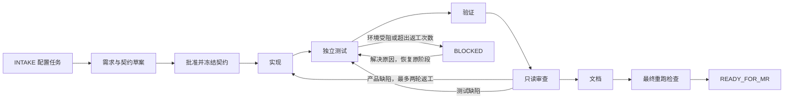

# Codex 多 Agent 研发流程

主 Codex 会话负责任务调度，五个专职 Agent 负责交付，Python 脚本负责检查阶段条件、记录真实执行证据。最终生成可供评审的 MR 摘要。



图中的阻塞以测试阶段为例；实际 `block/resume` 会保留并恢复任务的原阶段。`READY_FOR_MR` 表示本地门禁通过，不表示已经推送、创建 MR、合并或部署。

| 角色 | 输入 | 交付与文件责任 |
|---|---|---|
| 主线程 Orchestrator | 用户请求、仓库事实、授权记录 | 建任务、分派、推进状态、归档审查结论、处理阻塞 |
| `requirement` | 目标与约束 | requirements、interface、acceptance、open_questions 四份契约材料 |
| `coding` | 冻结契约、允许路径 | 业务代码与 implementation_report；不改测试或契约 |
| `testing` | 功能与性能验收条件 | 复用/补充必要测试、真实检查、test_report；产品缺陷交回 coding |
| `review` | 变更、契约、日志与报告 | 只读返回 findings 和决定，由主线程原样归档 |
| `documentation` | 已审查的实现与证据 | 使用说明与 documentation_report；不改实现 |

共享工作区最多同时运行两个子 Agent，代码与测试的写入阶段串行。只读准备工作可以与独立任务并行；子 Agent 不再向下委派。

测试按功能精简：长期保留对应功能验收和性能指标的必要用例，优先扩展已有功能/模块测试，不按任务、函数或验收 ID 复制脚本。性能测试有明确指标、负载和阈值，不适用时说明原因；纯文档等无行为变更不新增测试。测试计划与结果复用已有验收材料和一份任务报告，不另建成套测试文档。具体规则见 [AGENTS.md](AGENTS.md#lean-feature-testing)。

## 安装到目标项目

运行环境为 Linux/POSIX、Python 3.10+ 和 Git，Python 脚本没有额外包依赖。目标仓库需至少有一次提交，并提供自身构建、测试所需的环境和依赖。

当前文件位于 `pipeline/codex_agents_workflow/`，只是模板；其 Git 根仍是 `pipeline/`。正式使用时需把下列内容合并到**目标 Git 根**：

```text
<target-repository>/
├── AGENTS.md
├── .codex/config.toml
├── .codex/agents/*.toml
└── .workflow/
    ├── scripts/
    ├── templates/
    ├── README.md
    ├── ORCHESTRATION.md
    ├── PROMPTS.md
    └── gitlab-ci.example.yml
```

1. 先查看目标项目现有 `AGENTS.md`、`.codex`、`.workflow` 和 CI 配置，再逐项合并；不要覆盖已有规则或同名 Agent。
2. 合并本模板 `.gitignore` 中的缓存忽略规则。构建产物应按目标项目规则忽略，源码和实际验收输入不得因此漏检。
3. 默认不复制 `.workflow/tests/` 和 `.workflow/tasks/WORKFLOW-UPGRADE/`：前者只验证流程工具，后者是模板开发记录；业务项目只保留自身功能与性能测试。业务任务由 `init` 创建。
4. 如果要接 CI，先安装并调整 CI 示例，再初始化任务，避免最终快照之后才改变 CI 文件。
5. 在可信目标项目中启动新的 Codex 会话，检查五个自定义角色是否可用。项目配置不会追溯修改已经运行的父会话。

本次核对环境为 `codex-cli 0.166.0`，配置保留父会话模型，没有写死模型 ID。自定义 Agent 文件及继承权限的规则参见 [OpenAI 官方 Subagents 文档](https://learn.chatgpt.com/docs/agent-configuration/subagents)；项目指令的加载规则参见 [官方 AGENTS.md 文档](https://learn.chatgpt.com/docs/agent-configuration/agents-md)。

## 开始一个任务

在目标 Git 根运行：

```bash
python3 .workflow/scripts/workflow.py init --task TASK-0001
python3 .workflow/scripts/workflow.py status --task TASK-0001
```

先填写 manifest 的精确允许路径、必需验收 ID 和真实检查命令，再把 [启动提示词](.workflow/PROMPTS.md) 交给 Codex 主线程。已有明确授权直接沿用；只有尚未获得批准的公开契约或超出授权范围的动作需要确认。

- [逐阶段命令、manifest 与报告格式](.workflow/README.md)
- [调度、返工、恢复与契约变更规则](.workflow/ORCHESTRATION.md)
- [可复制的启动和恢复提示词](.workflow/PROMPTS.md)
- [GitLab CI 接入示例](.workflow/gitlab-ci.example.yml)

每个任务在 `.workflow/tasks/<TASK_ID>/` 保存契约、锁、manifest、阶段快照、四份角色报告、`verification.json`、日志和最终 `summary.md`。摘要包含实际命令、退出码、变更与限制，可作为 MR 描述材料。

## 验证模板

在当前 `pipeline` 仓库根执行：

```bash
PYTHONDONTWRITEBYTECODE=1 python3 -m unittest discover -s codex_agents_workflow/.workflow/tests -v
```

这些是流程工具自身的功能测试：27 项用例集中在一个约 22 KiB 的文件中，并非 27 个脚本；仅维护流程工具时运行，目标项目默认不用携带，也不加入每项业务功能的检查列表。测试使用临时独立 Git 仓库，不提交当前项目；此前独立复跑 27 项全部通过、退出码 0，记录见 [维护测试报告](.workflow/tasks/WORKFLOW-UPGRADE/test_report.json)。这验证的是本地流程工具，未验证真实业务、硬件或远端 GitLab CI。

脚本是协作检查工具，不是 Agent 后台服务、Webhook 监听器、权限沙箱或审批身份认证系统。完整边界见 [运行说明](.workflow/README.md#检测边界)。
